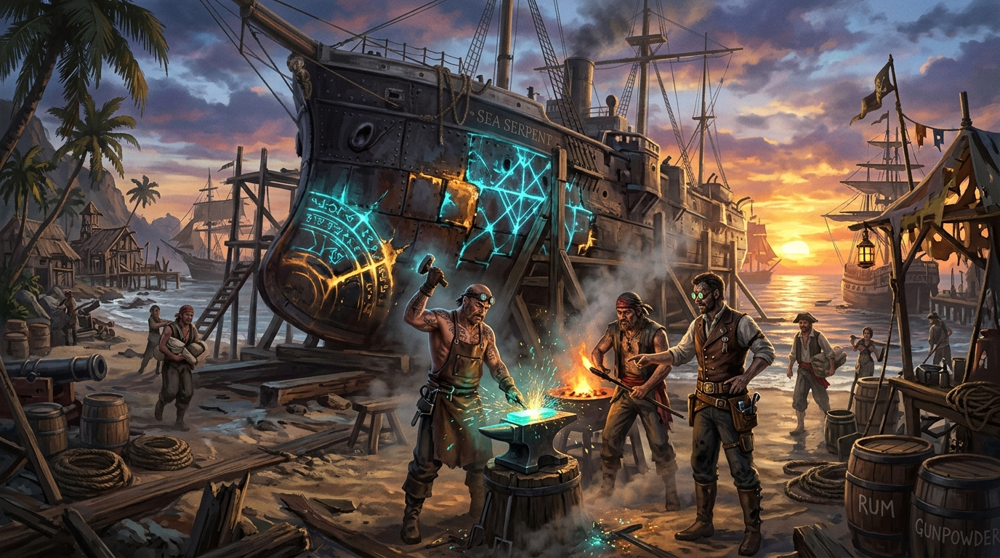

# 🔨 潮銅之火：托爾圖加的海盜與異邦鐵甲

這幅概念插圖呈現了《Blocksail》最核心的工程工藝衝突：新舊科技的異變交融——托爾圖加島（Tortuga）的「潮銅修補船塢」。

擱淺在熱帶海灘木製龍骨架上的，正是那艘從深淵湧昇中倖存下來的 19 世紀鐵甲艦。它的側舷裝甲在穿越重力管線時被壓得扭曲碎裂，蒸汽閥門與高壓活塞全數爆裂。

在加勒比海黃昏的金色霞光與熱帶木屋棚下，滿身煤灰的落難英國皇家海軍技師正與滿口金牙的托爾圖加海盜木匠、鐵匠圍在巨大的生鐵砧旁。鐵匠手起錘落，重重砸在一塊滾燙發光的亞特蘭提斯金屬「潮銅（Orichalcum）」錠上。

潮銅在高溫鍛造中不只泛著金黃熔漿，更脈動著如同海浪呼吸般的青藍色冷光結晶。當這塊古代合金被焊接並捶打進蒸氣船的破損外殼時，奇蹟發生了——金屬內部的共振迴路自發蔓延，宛如活體組織般自動鎖緊扭曲的鉚釘孔，將維多利亞式的厚重鍛鐵與亞特蘭提斯的導潮抗壓外殼牢固地縫合在了一起。

這就是《Blocksail》世界裡無數改裝戰艦的誕生地：既有熱帶海盜的狂野與烈酒，又有深海古代失落科技的優雅與肅穆。

