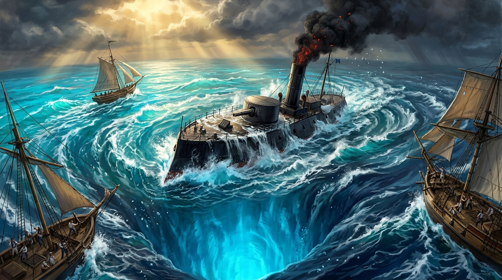

# 🌀 深淵湧昇：向風海峽的大漩渦與異時代來客

這幅概念插圖捕捉了亞特蘭提斯潮汐導管在加勒比海引發的極限時空擾動：向風海峽（Windward Passage）海難與「異時代來客」的破水瞬間。

根據世界設定，波多黎各海溝（Puerto Rico Trench）隱藏著亞特蘭提斯向西半球宣洩潮壓的高速深海導管。當主潮門重啟時，導管末端劇烈失衡，在加勒比海暖流與外海深水交會處捲起直徑數浬的重力逆向大漩渦。

但從漩渦深處噴湧而出的，不只是深海冷水——還有一艘來自 1860 年代、跨越了兩個世紀的黑色蒸氣鐵甲艦（Ironclad Outlander）。

高聳的鑄鐵煙囪正向熱帶烈日噴吐滾滾黑煙與赤紅火星，厚重的熟鐵鉚釘甲板上殘留著海鹽與古代青色螢光藻類，蒸氣管閥在海水冷卻下發出刺耳的尖嘯。在漩渦邊緣拚命轉向避開吸力的 17 世紀加勒比木造單桅快船與西班牙雙桅帆船上，滿臉驚恐的水手們緊抓著纜繩，無法理解眼前這艘既無白帆、通體包鐵、卻能以雷鳴般鐵輪衝破浪潮的異邦巨物。

加勒比海的海盜時代，就此被粗暴地推進了蒸氣與重裝甲的超前狂潮。

