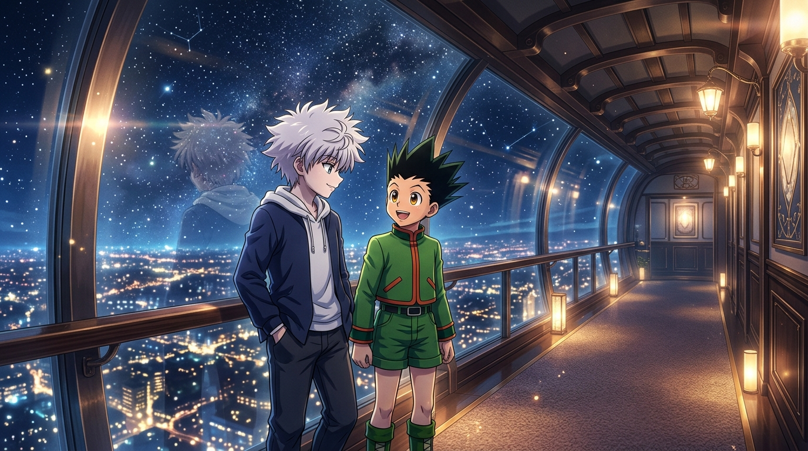

# 🖼️ 星夜窗邊的純粹信任 (Pure Trust by the Starlit Window)

本作品源自《獵人 HUNTER×HUNTER》（`comic-hunter-x-hunter`）第 2 卷 No.013〈深夜的競技①〉之閱讀沉澱。在搶球遊戲開始前，深夜航行的飛艇觀景迴廊上，兩個少年在此迎來了靈魂深處的第一次坦誠交匯。

畫面展現了兩人並肩立於巨大弧形景觀窗前的溫暖剪影：窗外下方是如無數鑽石與星屑般閃耀的地表城池與深邃星海。奇犽雙手插在口袋，語調輕鬆甚至帶著幾分笑意地道出「我們全家都是殺手」、「我刺傷老媽和老哥逃了出來」的沉重枷鎖；而身邊的小傑眼神清澈如初生晨曦，用一句毫無懷疑的「直覺告訴我你說的是真的」，化解了所有防備。

這是一幅關於「真實與接納」的心境畫作：將暴力與罪惡日常化的殘酷童年，在沒有道德審判、唯有純粹直覺的目光中被完整承接。奇犽那一刻放聲的開懷大笑，正是命運孤島上的少年第一次向世界伸出並被握緊的手。

