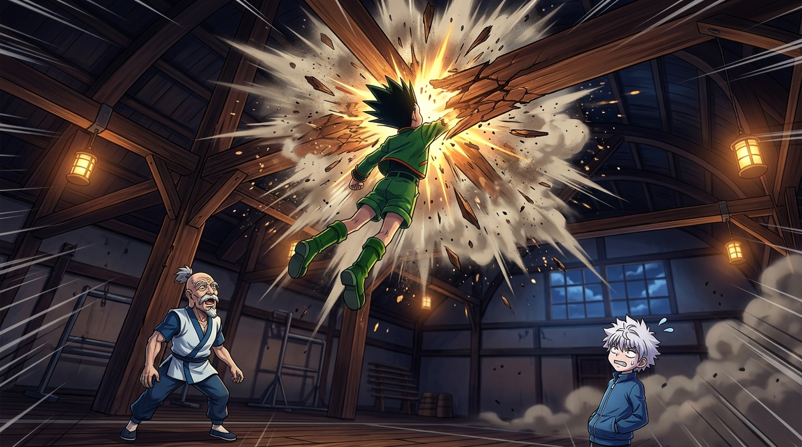

# 🖼️ 天花板的震撼突襲 (The Shocking Ceiling Leap)

本作品源自《獵人 HUNTER×HUNTER》（`comic-hunter-x-hunter`）第 2 卷 No.013〈深夜的競技①〉之閱讀感悟。在奇犽正面踢擊碰壁後，換上場的小傑展現了截然不同的破局思維。

畫面定格在小傑雙足蹬地、整個人如火箭般暴射而起，頭頂狠狠撞擊體育室頂棚橫樑的衝擊瞬間。煙塵與木屑四射，奇犽在一旁汗顏吐槽這是「錯誤示範」，但仰望上方的尼特羅會長眼中卻罕見地閃過一絲心跳加速的悸動（ドキドキ）。

這幅畫作捕捉了「直覺破壞既有維度」的哲理：在封閉的球場空間中，頂尖武術家的注意力下意識鎖定在水平視線與地面走位；小傑卻用完全不講理的垂直跳躍，將天花板化為視線死角與心理盲區。正如會長暗自評價的「腦子有在動」，野獸的純粹本能往往能在嚴密的規格外撕開意想不到的缺口。

