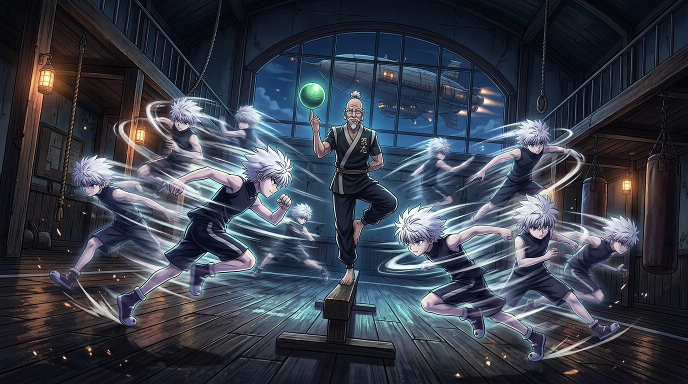

# 🖼️ 肢曲的殘影與鐵壁脛骨 (Rhythm Echo Clones and the Iron Shin)

本作品源自《獵人 HUNTER×HUNTER》（`comic-hunter-x-hunter`）第 2 卷 No.013〈深夜的競技①〉之閱讀心得。在深夜平穩穿行於雲海的獵人協會飛艇體育室內，獵人協會會長尼特羅提出以執照為賭注的搶球遊戲，拉開了實力差距的度量衡。

畫面聚焦於奇犽發動揍敵客家族高等暗殺步法「肢曲」的瞬間：利用步伐緩急在視覺中製造重重疊疊的虛假殘影，將無音暗步發揮到極致。然而中央單腿獨立的尼特羅會長僅以指尖旋轉排球，在奇犽全速低掃踢正中其脛骨時紋絲不動，反使奇犽骨震抱足。

這是一幅關於「技巧與厚度」的客觀哲思：暗殺術追求極致的感官欺騙與瞬間殺傷，但在歷經一個世紀千錘百煉的肉體密度與純粹防禦面前，破不了防就是最真實的讀數。老辣的從容與少年的鋒芒在深夜的木地板上交織成深刻的對拍。

