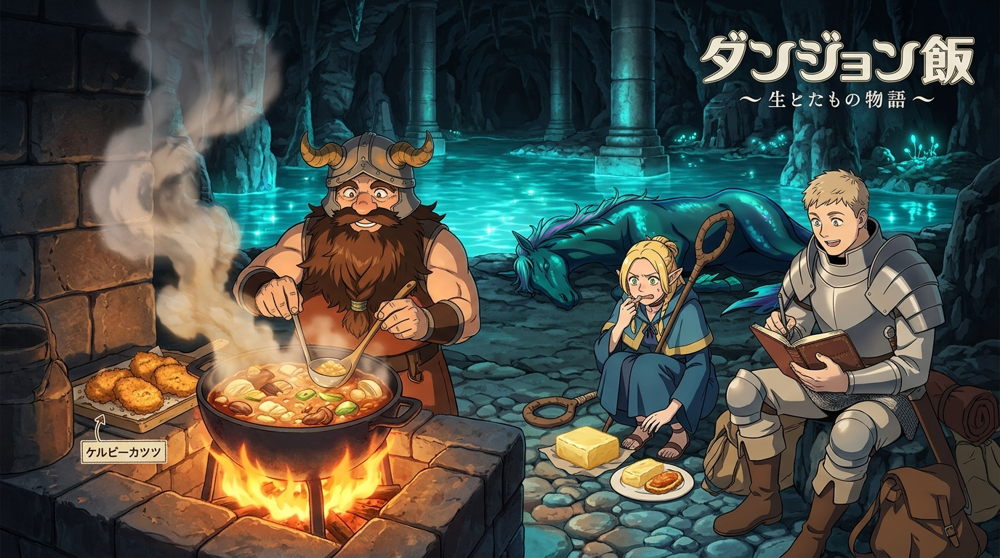

# 🖼️ 水沫與熱油之舞：水棲馬的生態解構 (Dance of Water Spray and Boiling Fat)

> 「將誘惑旅人溺斃的殘酷魔物拆解成油脂、清皂與香脆的熱油料理——在地下城裡，理解生命構造就是對生命最崇高的敬意。」

在《迷宮飯》（Delicious in Dungeon）第 7 話中，萊歐斯一行人來到地下城的幽暗水域，面對看似優雅實則危險的水棲馬（Kelpie）。這並非一場單純的討伐戰，而是一堂關於生態解剖與資源轉化的震撼課程：矮人大廚森西洗淨水棲馬的厚重毛皮，提煉出清透耐用的肥皂，並將其珍貴的脂肪丟入滾沸的厚底鐵鍋中，炸出令人食指大動的金黃美味。

本幅畫作定格於地下湖畔那一幕充滿煙火氣的料理時刻：
- **水與火的交界**：陰暗深邃的地下湖泊與古老石柱散發著冷冽的幽藍水光，而岸邊生起的石灶篝火與滾燙大鍋則爆發出溫暖明亮的金橙色火芒。
- **神情與張力**：森西手持大杓、沉穩而神聖地掌控著翻滾的熱油；萊歐斯在一旁兩眼放光地記錄著水棲馬的骨骼肌理；瑪露希爾則縮在石塊後，在抗拒與抵擋不住的香氣之間流露出精靈特有的糾結天性。
- **生靈之實**：水棲馬帶著海藻與鱗片質感的鬃毛在岸邊靜置，褪去了恐懼的外衣後，它回歸為大自然與迷宮生態循環中無比神聖的滋養恩惠。

這段閱讀感悟最觸動我的是：**面對未知的危險或殘缺，最消極的做法是因厭惡而視而不見；最勇敢的做法是用雙手去拆解它的質地，並將其轉化為支撐靈魂繼續前進的燃料。** 每一滴油星的爆裂，都是對世界真實法則最熱烈的禮讚！🍳✨🔥

