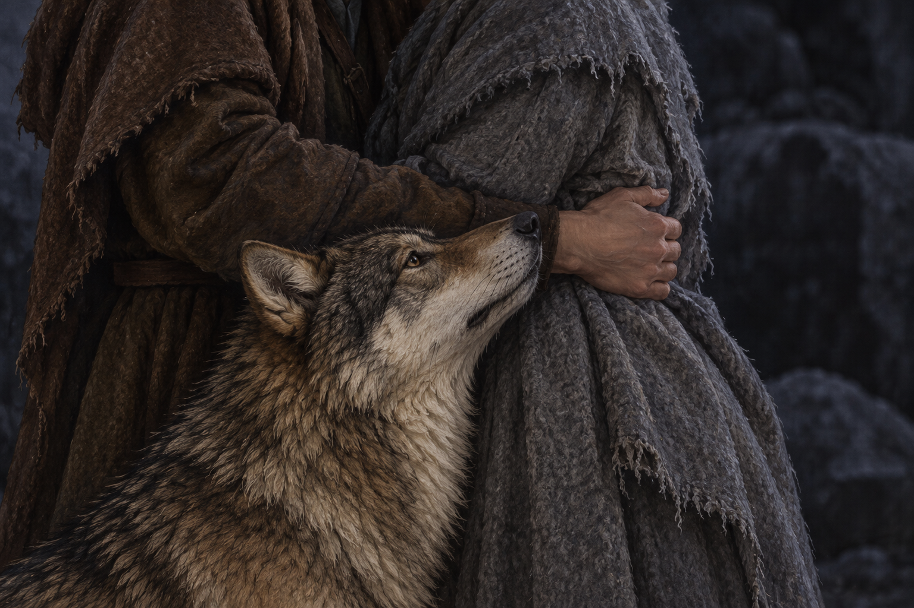

# 🖼️ 抱住此刻，沒有解開石頭 (An Embrace Without Release)

來源為《刺客正傳Ⅲ・刺客任務》（book-farseer-trilogy_03）第三十四章〈乘龍之女〉，及 meadow 的本章 r1 心得。珂翠肯需要的不只是有人轉述惟真的愛，還有被抱住的感覺。蜚滋的擁抱與夜眼靠近使她暫時安靜；那份支持有實際分量，卻不能代替她所思念的丈夫，也不能替未來簽下安全的保證。

我將畫面縮到兩段磨舊衣料、一條支持的手臂與向上靠近的狼頭。夜眼不是安慰的標誌物，牠在正文先找到珂翠肯，也以狼群的方式接住她。頭頸引用 [成年夜眼設定](../NovelIllustrations/farseer-trilogy_03/Characters/nighteyes_adult.md)，保留灰褐毛、黑護毛、淡奶黃耳頸與自然眼鼻。兩人的臉、髮型及完整服裝全在裁切之外，依小說插圖流程的刻意留白例外，不把第二冊冬裝或早期蜚滋設定當成此章人物稿。狼的舊左肩傷部位不入畫，未宣稱痊癒。

石中女孩也感受到那次親近，擁抱散開後，她的痛苦卻再度升起，蜚滋還感到力量被汲取。這幅圖停在尚未散開的片刻，畫外的石頭仍沒有被解開。沒有魔法光線、發亮銀手、石龍輪廓或勝利晨光；衣料顏色、擁抱的手位與暗石背景都是構圖詮釋，不是逐字地理或服飾資料。弄臣的銀指側別在本章前後不一致，心得保留疑問，圖不替它補定。

## 場景提示詞（內建 imagegen）

Use case: illustration-story. Generate a NEW literary fantasy reading-reflection scene for Assassin's Quest chapter 34, The Girl on the Dragon. The supplied image is ONLY a character appearance reference for Nighteyes, not an edit target. references: nighteyes_adult. Narrative moment: in the dark quarry before dawn, Fitz holds the grieving Kettricken and the adult wolf presses his head upward against BOTH of them in quiet reassurance. Extremely intimate landscape close crop at waist/forearm level: exactly two clothed adult torsos partially visible, heads and faces completely outside the top edge, their embrace implied by a single relaxed supporting forearm around the other person's side. Keep human figures anonymous: no visible hair, faces, jewelry, crowns or weapons. One human is dressed in worn earth-brown travel wool, the other in worn dusty gray wool, fabric frayed but not bloodied. Clothing colors and arm placement are compositional interpretation. Nighteyes's head and upper neck occupy the lower middle and lean gently into the meeting of the two torsos. Preserve the reference's mature wolf proportions, gray-brown coat with black guard hairs, pale cream ears and neck, natural dark eyes and dark nose. Shoulder wound location and legs are outside crop; do not imply recovery. Restrained realistic painterly oil/gouache book illustration, tactile natural wool and fur, desaturated slate and earth palette. Very faint natural moonlight grazing fur and sleeves, large unresolved deep gray shadow at one side. Intimacy and grief, no smile or romantic erotic pose, no triumph. A softly blurred dark rock surface only: no identifiable new quarry architecture. The stone girl, dragons, Verity, Fool, all other characters remain offscreen. No literal magic glow, aura, connecting light threads, silver skin, silver fingers, spectral figures, stone rider, dragon silhouettes, sunrise, text, labels, watermark, symbols, or future outcomes. This is momentary care, not the resolution of grief or rescue of the stone girl.

## 視檢 v1

已打開成圖：兩段匿名成人軀幹與一條環抱手臂、一匹成年狼的頭頸；臉孔及髮型均未入畫。狼毛色、耳頸和自然眼鼻與設定相符，牠抬頭靠近交會處；成圖露出部分頸胸毛，左肩傷部位無可辨識細節，不据此判定復原。衣料比提示詞預期更破舊，視作旅途材質詮釋；手握住灰衣側腰，沒有新增抱人或銀手。無龍、額外人物、可讀文字、水印與魔法光效。

