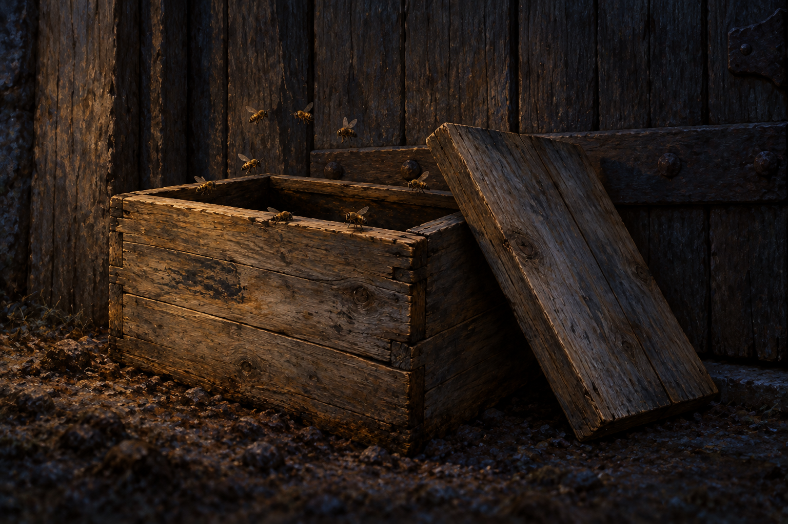

# 🖼️ 門前留下蜂聲 (The Bees Left at the Door)

來源：《刺客正傳Ⅲ・刺客任務》（book-farseer-trilogy_03）第三十六章〈原智和劍〉，以及 meadow 本章 r1 心得。莫莉離開窗口後帶回蜂箱，利用敵人對原智的恐懼爭回孩子。她讓博瑞屈先帶蕁麻離開，再倒退到門外，把開蓋蜂箱留下；這幅圖停在她已走入夜色、蜂聲仍在門前的片刻。

蜂箱引用新建的 [molly_escape_bee_box 設定](../NovelIllustrations/farseer-trilogy_03/Props/molly_escape_bee_box.md)。一個平日使用的東西，在危急中成為她自行找到的反制手段。圖裡沒有莫莉、孩子或博瑞屈，也沒有屍體與武器；她的勇氣由正文中先救孩子、再退離的動作承載，不靠勝利姿勢或可見魔法證明。她聲稱自己與孩子有原智，仍是當時的威嚇說法，沒有在這張圖替它定論。

惟真叫蜚滋停止觀看，以免敵人循他的目光追到家人的去向。於是畫面也在门前停下，只留一只開箱與幾隻蜜蜂。箱蓋支靠方式、木材、接縫、門板五金、土粒與冷暖光都是詮釋；不把它們拼成精確小屋復原。脫身已發生，博瑞屈的傷與後來是否安全仍待故事推進；蜂箱沒有替後續簽名。

## 提示詞（內建 imagegen）

Use case: illustration-story. NEW reading-reflection scene for Assassin's Quest chapter 36, title The Bees Left at the Door. Input image is ONLY a reusable wooden bee box prop reference, not an edit target. references: molly_escape_bee_box. Narrative moment just AFTER Molly has closed the old cottage door, left the bee box against it with lid open, kicked it, and gone off into the night. Close low-angle still life, outside the cottage: ONE box matching reference plain weathered rectangular boards and joins, open dark interior, flat lid tilted aside visibly open, resting directly against the lower part of ONE tightly CLOSED old wooden door. Several small ordinary bees fly around rim and near door, clearly natural insect scale, not an enormous swarm or magical figures. Focus on wood grain, box mouth and restrained movement of bees. Only a narrow strip of rough earth in foreground and door planks behind, crop out surrounding paths, windows, house architecture and woodland. Neither Molly nor the escaping family appears; their destination must remain offscreen. Night atmosphere, very low cold ambient light, tiny muted warm reflections on box from an UNSEEN source; no visible candle or fire. Restrained realistic painterly oil/gouache literary fantasy book illustration, muted umber and deep slate palette, wide composition. Clothing not applicable, no people, silhouettes, hands, weapons, blood, bodies, harmed children, signs of final deaths, footprints, readable writing, watermark, symbols, glow or mind-control threads. The prop form, soil texture, light and lid position are interpretation. Depict momentary escape and a tool left behind, not permanent safety, magical bees proved, happy ending or cottage destroyed.

## 視檢 v1

已打開成圖：一個同形木蜂箱，箱蓋斜靠側面、箱口開放，背後是關閉的木板門。少量蜜蜂可見，無巨大蜂群、魔法光、人物、血或逃走路線；右側門板五金與地面石粒屬生成的構圖詮釋，不作正文指定細節。暗色背景與箱口均可辨，沒有可讀文字或水印。

