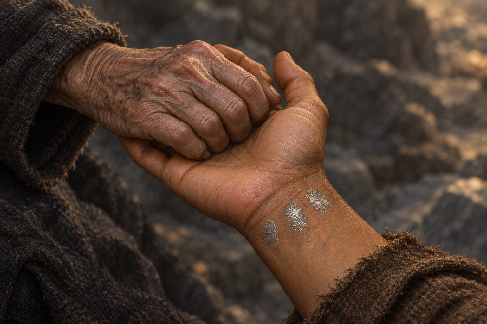

# 🖼️ 仍握著你的手 (Still Holding Your Hand)

來源：《刺客正傳Ⅲ・刺客任務》（book-farseer-trilogy_03）第三十五章〈水壺嬸的秘密〉，以及 meadow 本章 r1 心得。蜚滋向弄臣伸出左腕，讓他接到自己並不恨他的心意；銀色指尖離開之後，蜚滋仍握著茶隼的手。他不只尋找被封閉的力量，也試著讓她回到仍存有姐妹之愛的記憶。

畫面停在兩隻手相握的局部。新建 [左腕三銀印設定](../NovelIllustrations/farseer-trilogy_03/Props/fitz_left_wrist_silver_imprints.md)，引用已修正手側的 v2。三道銀印不是勝利徽章：它們留下觸碰，也留下敏感的代價。茶隼曾請求開啟力量，蜚滋仍以強行穿過防衛的方式接近；這份支持不能被畫成毫無張力。老婦的關節、繭與皺紋依章內描述取意，人物臉孔、髮型及全身服裝都在畫外，依刻意留白例外不冒充完整當章人物稿。

茶隼與海鷗的童年在記憶裡重新可見，不是死者肉身復生，也不使殺害姐妹的責任消失。成圖不畫幽魂、少女、狼、惟真或石龍；石面、斜光、布色與具體握法為構圖詮釋。圖中沒有魔法絲線或發光救贖，留給下一刻的力量與工作仍待發生。珂翠肯在共同雕刻之外的處境，也不因這次突破被抹去。

## 場景提示詞（內建 imagegen）

Use case: illustration-story. Generate a NEW reading-reflection scene for Assassin's Quest chapter 35, not an edit of the reference. references: fitz_left_wrist_silver_imprints v2. Narrative moment AFTER the Fool lifts his silver fingertips from Fitz's wrist, BEFORE Kettle lets go: Fitz still holds elderly Kettle's hand, keeping their human contact during the attempt to reopen her Skill. Extreme intimate close crop of exactly TWO hands and short forearms only: one young adult LEFT hand, medium brown skin, palm angled upward with its THUMB ON THE VIEWER'S RIGHT, three discrete silvery fingerprint patches on the inner wrist just below the palm, match the reference's placement, subdued sheen, frayed brown cuff drawn back. One elderly woman's weathered hand in a plain dark sleeve gently but firmly clasped across the young palm; swollen bony knuckles, work calluses, wrinkles, no jewelry. The THREE silver wrist prints remain unobstructed. Wrist geometry and LEFT-hand anatomy must match the reference. The old woman's precise hand side is unspecified; a believable anatomically coherent clasp, no extra fingers or hands. No other body parts, no faces, no hair. Restrained realistic painterly oil/gouache literary fantasy art, textured woven wool, muted earth and slate palette, close tactile skin. Background only softly blurred dark rock, ambiguous quarry setting; slanting late-afternoon daylight, no fire or identifiable new architecture. Quiet tension and tenderness, never triumphant. Clothing shade, old hand appearance, hand positioning and light are compositional interpretations. No literal magic glow, aura, silver old fingers, connecting threads, blood, burn wounds, rings, dragon, girl statue, hallucinated twins, wolf, tools, cups, text, labels or watermark. A moment of contact, not forgiveness granted by the dead, not dragon completed, not a medical cure. Landscape image.

## 視檢 v1

成圖已打開：兩隻成人手與袖口，一隻年輕左掌朝上、拇指在觀者右側，老婦皺褶手在掌上相握；腕內側三枚分離銀印可辨，未被遮住。銀印與 v2 參考相符；衣料、握法及暖斜光為詮釋，右上暖色無可見火焰。没有额外手臂、人物臉、龍、可讀文字、水印或魔法光線。

