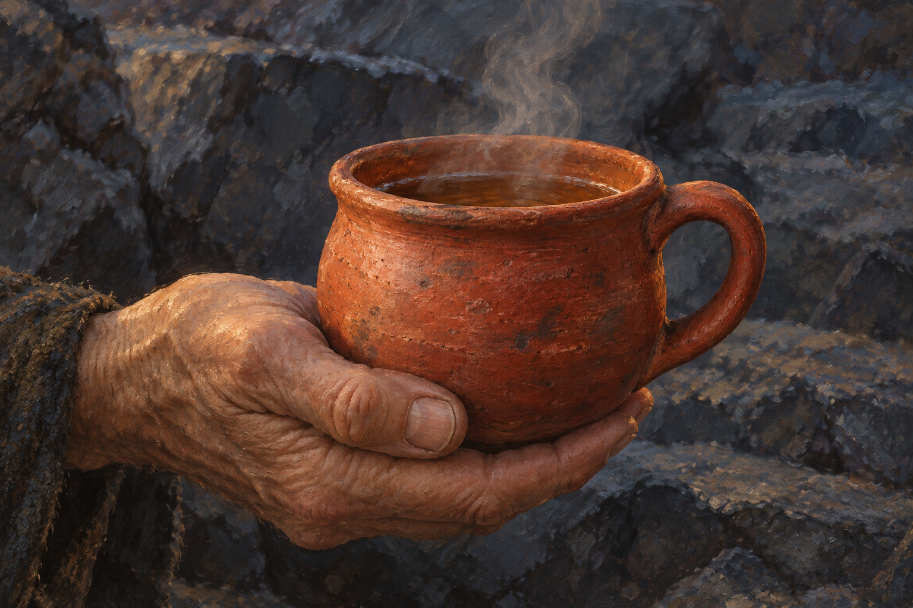

# 🖼️ 先讓溫度回到身體

來源為《刺客正傳Ⅲ・刺客任務》第三十三章〈露天礦場〉，[meadow 第一輪心得](../../BookNotes/Library/media/book-farseer-trilogy_03/readers/meadow/chapters/0033/r1_2026-10-11.md)。找到惟真之後，同行者面對的是一位仍在勞動、卻逐漸把記憶交進石龍的國王。水壺嬸不否認他拯救人民的理由，而是讓今晚先有熱茶、食物與睡眠。

惟真喝茶時想起母親，又想把這份記憶放進龍裡。我把畫面停在杯子被遞出之際：照料尚不能恢復他認出妻子與共同悲傷的能力，溫度卻可以先到達他的身體。小小的蒸汽與冷石同在，讓使命之外的需要仍被看見。

珂翠肯的喪子、不能觸碰的雙手與她轉向夜眼的陪伴，全都留在畫外。這杯茶不替他們和解，也不宣告石龍完成或六大公國已獲救。水壺嬸關於精技殺人和犧牲棋子的解釋仍是角色推論；畫面只保留本章確實發生的照料。

## 場景規格與引用

- 引用已打開視檢的 [camp_red_tea_cup](../NovelIllustrations/farseer-trilogy_03/Props/camp_red_tea_cup.md) v1，只沿用厚口、低圓腹、單環把手、無紋紅褐陶土的視覺語彙。本章只確認茶杯、蕁麻與少量薄荷茶，沒有確認杯色、形制或與第十一章杯子的物理同一性。
- 一隻匿名年老手從左下托杯，沒有面容或可辨識衣裝；此為工作流的刻意留白例外，不作水壺嬸完整人物設定。惟真、石龍、狼、銀色雙手與其他同行者皆不入畫。
- 傍晚冷灰石面、畫外弱暖光與陶土材質是構圖詮釋，不鎖定露天礦場完整布局，也不畫魔法發光、雕刻成果或療效。

## 生成提示詞與版本

內建 imagegen，以陶杯設定稿為唯一圖像參考。實際提示詞如下：

Use case: illustration-story. Create a hand-painted realistic literary fantasy reading-reflection illustration for Robin Hobb's Assassin's Quest, Farseer Trilogy volume 3 chapter 33 The Quarry. Narrative moment: Kettle offers warm nettle-and-mint tea to Verity, who has nearly forgotten warmth while carving his stone dragon. References: camp_red_tea_cup. Use the attached reference ONLY for the clay cup shape and material: squat rounded muted brick-red terracotta body, thick rolled lip, one simple sturdy loop handle, rough matte firing marks, no ornament. This shape is artistic interpretation, not a claim this is the same physical cup as chapter 11. Intimate horizontal close crop: exactly one naturally wrinkled elderly human hand extends from the lower left, supporting the single cup securely beneath its base, fingers naturally curved; the cup is filled with dark herbal tea and delicate steam rises. Keep hand and cup modest, emotionally tender, not heroic. Cool dusk light on rough anonymous dark quarry stone in the soft background, only a little restrained warm light from outside the frame reflecting on clay. Painterly oil and gouache with visible brushstrokes, tactile paper grain, muted charcoal gray, earth brown and terracotta. All faces, bodies, recognizable costumes, recipient hands, silver magic arms, dragon, sword, tools, wolf and other characters remain outside the frame. No visible herbs, kettle, saucer, second cup, letters, captions, border or watermark. Not a modern coffee product photograph. This is a small offer of care with sorrow unresolved, no magical cure, triumph, reunion or completed dragon.

## 視檢與驗收

v1 已打開視檢：單一紅褐厚口圓腹杯、單環把手、茶液及蒸汽，一隻自然彎曲的局部老年手托住杯底。冷灰黑石與有限暖光保留可見筆觸。無可辨識人物、銀色手臂、龍、第二杯、文字或水印；杯身與把手沿用設定，衣袖材質和手紋僅為匿名局部詮釋。

畫廊索引重建與 `--check` 通過，無圖片缺失警告。本機 HTTP 畫廊已在瀏覽器驗證：最新首頁、閱讀心得分區及點擊大圖預覽皆顯示本展品，圖片與展卡內文正常。

