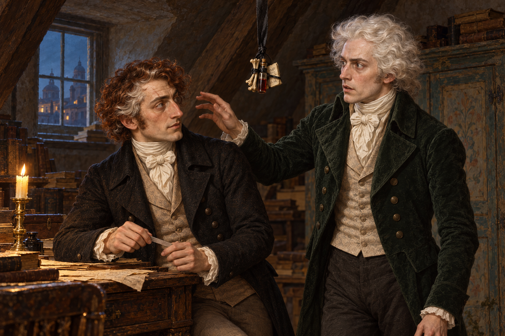

# 🖼️ 看見之後

來源為《英倫魔法師》（Susanna Clarke，book-jonathan-strange-mr-norrell）第53章〈一隻死了的小灰耗子〉。多次試驗知覺後，斯特蘭奇念出召喚詞，仍專心磨指甲；白髮先生靠近欲揪頭髮，他卻抬眼問對方有沒有鼻煙，令仙靈停住。畫面留在這個不相稱的相逢：來者以為自己掌控局面，問話的人却沒有按照交涉的規矩注意他。

我不把這一刻畫成勝利。斯特蘭奇曾連「正常」的判準都辨不清，自覺冷靜的那次又把研究稿上的自己當成另一個人。終於能看見，不等於能掌握作用何時結束，也不讓先前拿走老夫人食物、未得回答就施咒的舉動變得合理。指甲銼很普通，停住的手也很普通，兩者之間卻是一條仍未穩定的知覺界線。

黑綢懸帶上的骨、液體与纸片尚未碰到額頭；下一章才能接續它的作用。兩人的距離、桌邊身姿、家具局部與照明是場景詮釋；不畫阿拉貝拉幻影、頭中燭火、菠蘿、灰耗子入口或後續結果。只取這間研究頂樓，不與第52章老夫人的貓閣樓混用。

## 設定與生成

- 人物：[jonathan_strange_1814](../NovelIllustrations/jonathan-strange-mr-norrell/Characters/jonathan_strange_1814.md)，v2；[white_haired_gentleman](../NovelIllustrations/jonathan-strange-mr-norrell/Characters/white_haired_gentleman.md)，v1。
- 場景：[venice_attic_nightshirt](../NovelIllustrations/jonathan-strange-mr-norrell/Props/venice_attic_nightshirt.md)，v1，局部引用彩繪櫥與桌。
- 新道具：[hanging_black_ribbon_bundle](../NovelIllustrations/jonathan-strange-mr-norrell/Props/hanging_black_ribbon_bundle.md)，v1，先建卡與視檢再出場。
- [完整提示與視檢紀錄](../NovelIllustrations/jonathan-strange-mr-norrell/053_after_seeing_spec.txt)，內建 image_gen，以四張已打開檢查的設定圖生成。
- 心得正本：BookNotes/Library/media/book-jonathan-strange-mr-norrell/readers/Sirius/chapters/0053/r1_2026-10-13.md；斯特蘭奇v7、德爾加多夫人v2看法，書籤054。

## 成圖視檢（2026-10-13）

v1恰有兩名男性：左側紅棕髮帶白髮、長鼻與眉上疤，右側銀白髮、深綠外套。伸出的手與頭髮有可見空隙；左側手持小銼、兩人互看。懸帶束物在兩人中上方，小骨、液體管與摺紙可見，不碰額。指甲銼、兩手、桌面、彩繪櫥與夜窗可辨；無文字、水印、光效、額傷或其他人物。

生成與規格差異：斯特蘭奇背心為淺褐而非提示預定黑色；外套仍黑，作本張衣料詮釋，不指稱為正文服色。桌邊姿勢較低，束物相對他的額頭略高，並非精準重建站位；本文只取「看見、停手、尚未相碰」的敘事關係，不把具體幾何當作原作事實。

