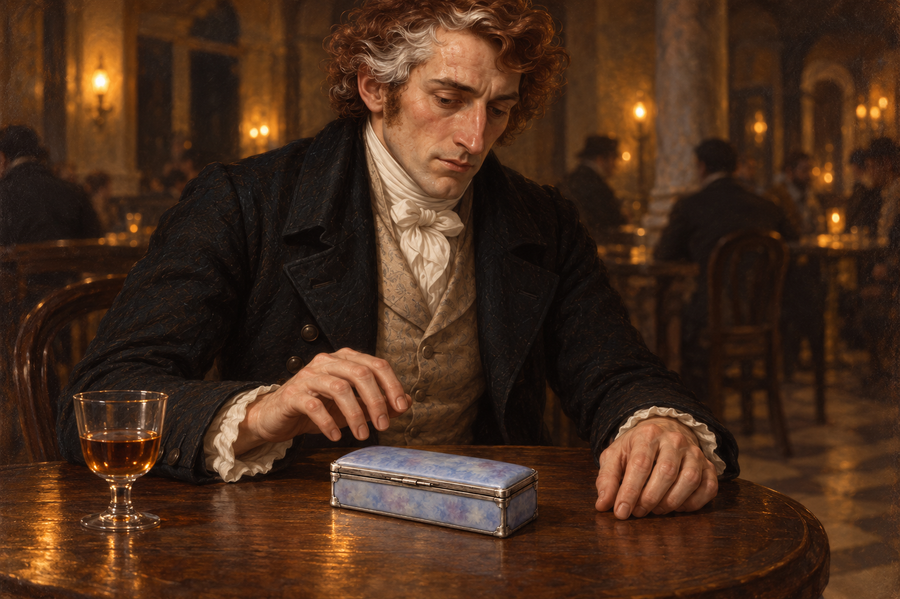

# 🖼️ 再次開匣之前

來源為《英倫魔法師》（Susanna Clarke，book-jonathan-strange-mr-norrell）第54章〈一隻小匣子，色如心傷〉。斯特蘭奇要求仙靈交出此前交易的收穫，希望由物件學到知識；漂亮的匣子到手後，他卻急忙合上，又到人多的咖啡館重新檢查。這張圖取再次打開之前的片刻，將停住的手與銀瓷的冷色放在同一張桌上。

匣子美麗，並不能替其中的身體代價辯護。家人辨認了美物，他卻口頭說它是空的；知識尚未到手，恐懼已經使他無法在飯桌上說明。我想留下這種差異：不是每件未知都能被稱作空白，也不是每項求知都能讓取來的物品失去原本的主人。畫面不展示手指，心得保留他觸摸後的判斷，以及尚未認出歸屬的問題。

人物沿用1814戰後面貌，新匣子先設定、視檢再引用。咖啡館家具、窗光、玻璃杯與人群位置為場景詮釋，並非已知建築平面；背景模糊客人只表現他選擇人多處的動機，不作可辨識新角色。書末發光道路、黑鳥幻象與仙境目的地不出場。

## 設定與提示

- [jonathan_strange_1814](../NovelIllustrations/jonathan-strange-mr-norrell/Characters/jonathan_strange_1814.md)，引用v2。
- [heartache_silver_porcelain_box](../NovelIllustrations/jonathan-strange-mr-norrell/Props/heartache_silver_porcelain_box.md)，引用v1。
- [完整提示與紀錄](../NovelIllustrations/jonathan-strange-mr-norrell/054_before_opening_again_spec.txt)，內建image_gen，以兩張已打開檢查的設定圖生成。
- 心得正本：BookNotes/Library/media/book-jonathan-strange-mr-norrell/readers/Sirius/chapters/0054/r1_2026-10-13.md；全章146行已讀，書籤055。

## 視檢（2026-10-13）

v1一位可辨人物，紅棕白髮、長鼻、眉上舊疤、黑外套與白領巾沿用；右手懸於閉蓋匣上，左手放桌，雙手可見。匣子保留銀邊與藍丁香紫灰瓷面；一杯琥珀色酒、暖燭光與數位遠景剪影可見。閉蓋沒有內容物、血與傷口；無文字、水印、法術光效、發光道路或可辨認的新角色。具體停頓、桌子與杯形為詮釋；本章未定服色，淺色背心沿用參考。

