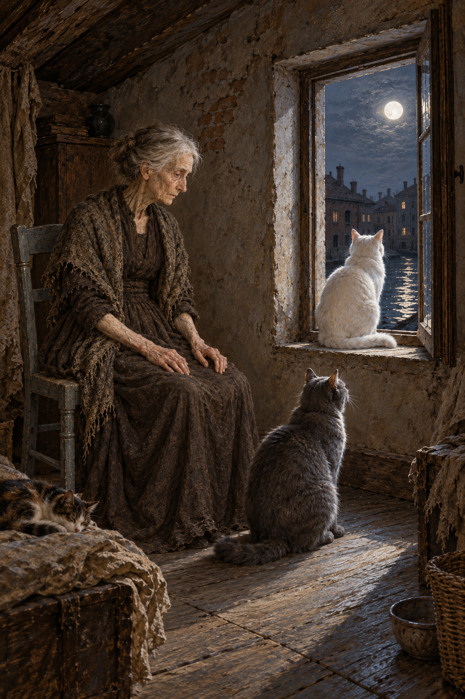

# 🖼️ 視線離開問話

來源為《英倫魔法師》（Susanna Clarke，book-jonathan-strange-mr-norrell）第52章〈卡納雷吉歐的老夫人〉。格雷斯蒂爾一家帶著善意登上閣樓，不斷問候、換語言、提高音量；德爾加多夫人仍未回答。訪客開始用耳聾和孤獨解釋她，可正文同時讓她的視線有了方向：灰貓、白貓、月亮。

我想留住的是這段不朝向訪客的注意力。她沒有接住問題，不等於她的世界沒有正在發生的事。畫面沿她的側臉和低處灰貓，通往窗台上的白貓與開窗夜色；月光沒有替她揭露身分，也不為沉默提供診斷。章末驚恐關上的門，還擋著未知，這張圖不去替它打開。

角色設定保留極瘦年老、薄而帶紋的皮膚、褐斑與雙臂搭腿。灰髮、衣料、房間布局與窗外屋影是視覺詮釋；正文的魚、蛛網比喻不轉成怪物解剖。訪客都留在畫框外，只取屋內三隻貓；不畫章末獵物、變形、門後行動或第53章劇情。

## 場景規格與引用

- 人物：[mrs_delgado](../NovelIllustrations/jonathan-strange-mr-norrell/Characters/mrs_delgado.md)，引用 mrs_delgado_v1.png。
- 場景：[cannaregio_cat_attic](../NovelIllustrations/jonathan-strange-mr-norrell/Props/cannaregio_cat_attic.md)，引用 cannaregio_cat_attic_v1.png。
- [完整生成提示與視檢記錄](../NovelIllustrations/jonathan-strange-mr-norrell/052_gaze_beyond_questions_spec.txt)。使用內建 image_gen；兩份設定先生成、視檢與建卡，再作場景參考。
- 閱讀心得：BookNotes/Library/media/book-jonathan-strange-mr-norrell/readers/Sirius/chapters/0052/r1_2026-10-13.md，人物看法 mrs-delgado v1，書籤下一章053。

## 成圖視檢（2026-10-13）

v1一位老夫人、三隻貓可見：中下方大灰貓、窗台白貓、左下眠貓。人物側臉低向灰貓，灰貓抬頭向白貓，白貓朝窗外月亮；身分、灰褐衣服、手臂與灰椅沿用設定。參考圖的椅上眠貓已移開，右側眠貓未入畫，是局部取景的差異。沒有文字、水印、額外人影、魔法、變形與死鳥。細微眼神不能作精密視線量測，這裡記的是可見頭部朝向與構圖關係。首頁、閱讀心得分區與大圖預覽已於本機瀏覽器確認；build_gallery.py --check 通過。

