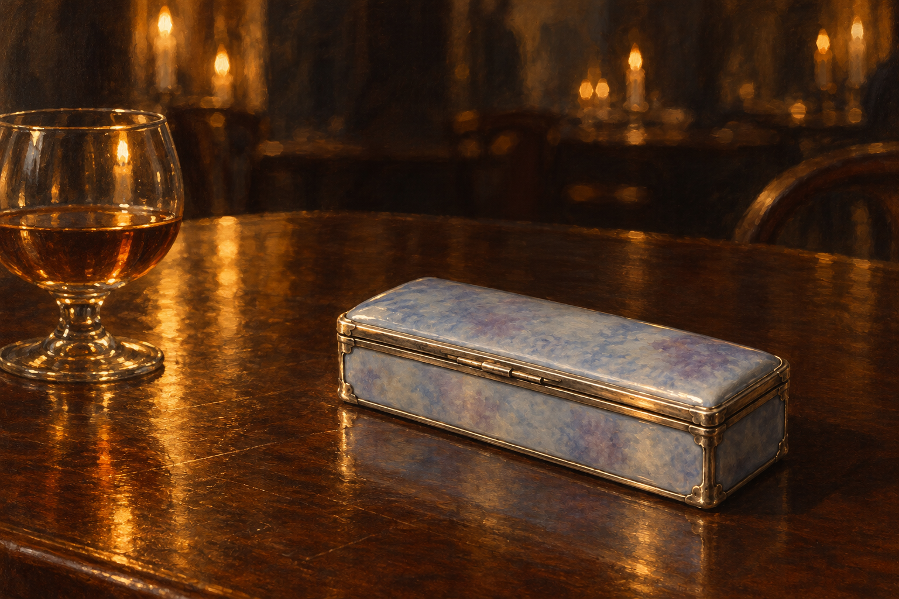

# 🖼️ 瓷釉沒有說的事

來源為 Susanna Clarke《英倫魔法師》第54章〈一隻小匣子，色如心傷〉。斯特蘭奇收到銀與瓷製的小匣，看過內容便急忙合蓋，隨後去人多的咖啡館再次檢查。本圖是重開前的詮釋裁景；人物在框外，沒有宣稱匣子在他離開後留在桌上。

我想把本章那份美與不安單獨留下：丁香紫混灰的瓷面可以被欣賞，卻没有交代物品原來的主人，也沒有使求知者得到理解。銀邊的閉合線在暖反光裡仍清楚。它擋住了觀看，但不能將尚未說明的代價變成不存在。

沿用已視檢的[銀瓷匣v1](../NovelIllustrations/jonathan-strange-mr-norrell/Props/heartache_silver_porcelain_box.md)。白蘭地依正文，一杯酒作尺寸參照；杯形、木桌、燭光與背景座椅為詮釋。咖啡館只取不可辨識的局部背景，不建立新的建築平面設定；沒有可辨人物。心得正本為 BookNotes/Library/media/book-jonathan-strange-mr-norrell/readers/Sirius/chapters/0054/r1_2026-10-13.md。

[完整提示與規格](../NovelIllustrations/jonathan-strange-mr-norrell/054_glaze_unsaid_spec.txt)；使用內建image_gen、設定圖作道具參考。

## 視檢（2026-10-13）

v1一隻閉蓋長方銀瓷匣與一杯琥珀色酒；藍丁香紫灰釉面、金屬銀邊與小匣比例保留。近景的匣子是透視放大，未定厘米尺寸；圖中無人物、手、內容物、血、文字、水印或發光道路。暖色金屬反光不視為改用金材。

