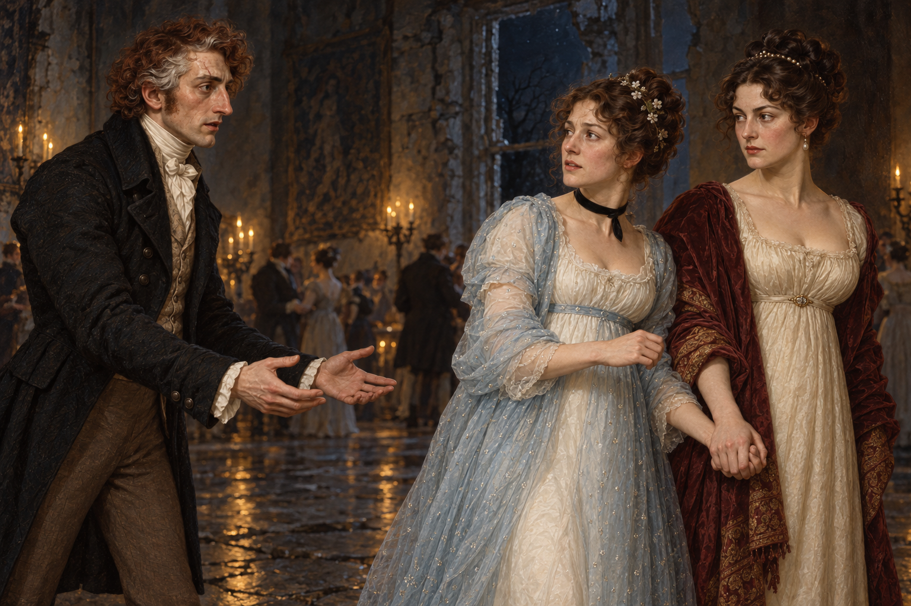

# 🖼️ 她握住的手 (The Hand She Chose)

來源為 Susanna Clarke《英倫魔法師》（book-jonathan-strange-mr-norrell）第55章〈後者之寶，此生珍愛，落敵人魔爪〉，1816年12月2日夜至3日凌晨。斯特蘭奇走進喪冀舞會，終於看見阿拉貝拉；他伸出雙手，她沒有接，而是略微退縮、握住身旁女人的手。畫作停在談話尚未被白髮先生打斷、舞會尚未消失的片刻。

我把兩組手放在同一個畫幅裡：左邊是遲來而真切的伸手，右邊是已在困境中建立的扶持。阿拉貝拉仍向同伴表達希望，期待丈夫是來幫忙的；戒備沒有抹去喜悅，喜悅也沒有自動使她放心。中央留白讓這兩種感情都有位置，不把抵達畫成已完成的救援。

同伴的失望與反覆追問有其重量，但她打斷別人的話同樣值得保留。我沒有把她畫成阻擋夫妻團聚的反派，也沒有讓阿拉貝拉只是被保護的物件。讀到史蒂芬求放人的話被曲解成加害方案，更使我珍惜這次握手：理解一個人的需要，不能僅靠把他的句子接進自己的計畫。

三人臉部依已視檢的既有設定。阿拉貝拉白裙、淡藍鑲鑽網眼罩袍、髮上小花枝及黑天鵝絨頸帶依本章；坡夫人的象牙白裙與暗紅披肩沿舊設定作服裝詮釋，本章沒有確認她的精確服色。角色距離、鏡頭、匿名舞者、潮濕石地與牆面幾何均是構圖詮釋；不從背景反推喪冀的建築平面。缺指和銀瓷匣不作主題，也不展示身體傷口。尚未閱讀056，不畫法術後果或救援結果。

## 引用設定與生成紀錄

- [斯特蘭奇1814年後](../NovelIllustrations/jonathan-strange-mr-norrell/Characters/jonathan_strange_1814.md)：v2，長鼻、紅棕與灰髮、眉上舊疤。
- [阿拉貝拉](../NovelIllustrations/jonathan-strange-mr-norrell/Characters/arabella_woodhope.md)：v1臉部身分，本章服裝另依正文。
- [坡夫人](../NovelIllustrations/jonathan-strange-mr-norrell/Characters/lady_pole.md)：v1，蒼白皮膚與深棕盤髮。
- [喪冀石廳](../NovelIllustrations/jonathan-strange-mr-norrell/Props/mourning_wings_dance_hall.md)：v1材質與冷夜基調；第55章的局部構圖不固定為全貌。
- [完整生成提示](../NovelIllustrations/jonathan-strange-mr-norrell/055_hand_she_chose_spec.txt)：內建 image_gen，以四張已開啟視檢的設定圖生成，無透明背景。
- 閱讀心得正本：BookNotes/Library/media/book-jonathan-strange-mr-norrell/readers/Sirius/chapters/0055/r1_2026-10-18.md；055.txt全章逐行讀畢，書籤056。

## 視檢（2026-10-18）

v1為1536×1024橫幅。三名可辨主體：斯特蘭奇左側伸出兩隻空掌，沒有碰到阿拉貝拉；阿拉貝拉轉身看他，右側兩位女性在腰邊握手，她另一手收在胸前。黑頸帶、淡藍網紗、小花枝與白裙可見，神情含驚訝與不安；坡夫人注視斯特蘭奇，深棕盤髮、象牙裙與暗紅披肩沿用。遠景少量匿名舞者、石牆、夜窗和燭火均可見。背景破牆與瓦礫沒有成為清楚可辨的全景，當作局部場景而非建築紀錄。沒有文字、水印、血雨、可辨仙靈新角色或後文咒術。服裝亮點是珠鑽與燭光的畫法，不是另加法術。小指未作近景或傷口呈現，不用此圖驗證缺指狀態。

