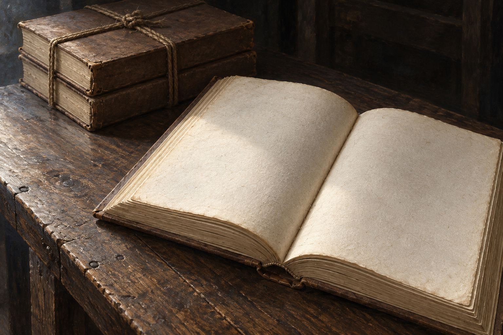

# 🖼️ 空白的重量

來源為 Susanna Clarke《英倫魔法師》第50章〈《英格蘭魔法的歷史與實踐》〉。夏先生確認一萬本仍捆著，後來打開檢查才發現文字已全數消失。這張補圖把鏡頭拉近書脊、紙纖維與繩結；桌角與倉庫背景是我依報信內容安排的視覺詮釋，正文没有給出此處平面或視角。

我在已存的閱讀心得裡停在這個差別：外殼與數量的確認有其真實性，卻不能回答頁面還能不能讀。書攤開以後，空白也有紙的厚度與陰影。將它放在眼前，是想讓被抹去的內容與仍可搬動的實物同時占住畫面。

沿用已視檢的[空白書冊設定v1](../NovelIllustrations/jonathan-strange-mr-norrell/Props/strange_history_blank_volume.md)。棕色封面、奶油紙與粗繩保留，斜俯角和冷側光為本次構圖；只画一小捆，不能從圖推導精確一萬冊，也不代表兩本倖存的狀態。心得正本為 BookNotes/Library/media/book-jonathan-strange-mr-norrell/readers/Sirius/chapters/0050/r1_2026-10-12.md。

[完整提示與規格](../NovelIllustrations/jonathan-strange-mr-norrell/050_weight_of_blankness_spec.txt)；使用內建image_gen、設定圖作道具參考。

## 視檢（2026-10-13）

v1一冊打開的無字書與左後方一捆閉合書冊；封面、紙色、粗繩沿用。冷側光落在紙纖維上，無人物、手、文字、水印、光效、焚燒或消散。書邊的磨損為材質詮釋，不當作受法術毀損的證據。

