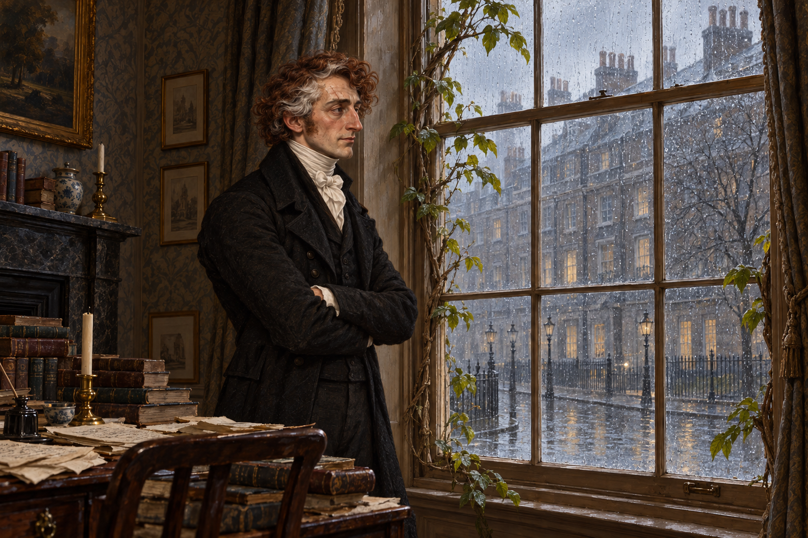

# 🖼️ 等雨停了再說 (Waiting for the Rain to Stop)

出處：《英倫魔法師》（book-jonathan-strange-mr-norrell）第49章〈狂野與瘋癲〉，1816年3月，全章已讀。斯特蘭奇先維護占住椅子的書，後來又在談話裡把國王的特殊知覺連向如何令自己瘋起來的猜想。我想留住他還站在客廳的時刻：求知正在向危險傾斜，窗外仍只有普通的倫敦密雨。

本章對教跳舞者的欣賞，使魔法不必由紳士獨占；但對女性申請者的原則開放，尚未變成真正的教學安排。他說研究優先，窗邊堆疊的書稿便承接這種注意力的重量。這不是把學習判為冷漠，而是保留他口中的歡迎與付出時間之間尚有的距離。

人物引用 `jonathan_strange_1814` 的紅棕捲髮、灰白髮束、瘦削長鼻與左眉上方舊疤；當次黑色喪服沿第48章狀態，抱臂取第49章章末明示動作。窗框長葉沿本次新設定，窗外不畫荒野或仙境；爵士和勛爵在畫框外，未新增可辨識人物。無阿拉貝拉幻影、召喚結果或疾病轉成魔法的圖像。

他的自嘲微笑可以讓人認得過去的他，並不證明哀傷已解除。雨停以後會怎樣，本章未回答；我把窗留作窗，把猜想留在猜想的位置。

## 生成與驗收

使用內建 imagegen。先繪無人物 `soho_leaf_window_rain_v1` 設定稿，打開檢視後，連同已重看的人物 `jonathan_strange_1814_v2` 作為兩張參考圖生成場景。最終v1已視檢：恰為一名人物、抱臂、紅棕與灰白髮、黑衣白領巾，窗框枝葉清楚，窗外為普通雨街；無仙境、額外人物、可讀文字或水印。左眉上方舊疤在側面視角中不如設定稿清晰，未把細部完全一致當成已驗證。2026-10-12索引重建及 build_gallery.py --check 通過，917件／916件有圖，無缺圖警告；首頁、閱讀心得篩選、大圖預覽皆已確認。

## 場景規格與 prompt

參考1鎖人物臉部與髮色，參考2鎖長葉窗框、普通廣場雨景和凌亂書稿。單一人物，腰上三分之四側面，抱臂望窗，黑喪服配白領巾，疲憊中有很淡的自嘲笑意。灰褐室內與冷灰雨光，歷史文學油畫質地；位置與鏡頭是詮釋。禁止額外人物、荒野、仙靈、魔法門、光效、可讀文字、水印、戒指特寫與後續劇情。完整英文 prompt 見作品台帳同層 `049_waiting_for_rain_spec.txt`。

