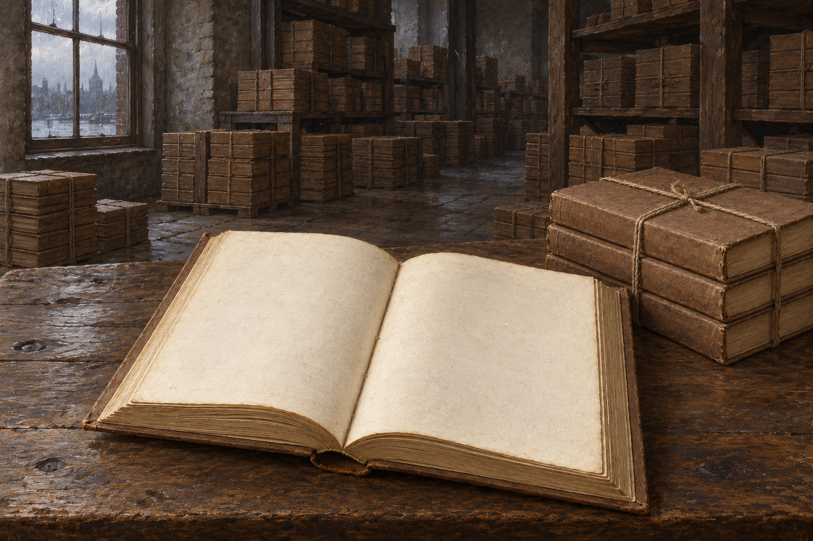

# 🖼️ 一萬本空白 (Ten Thousand Blank Volumes)

出處：《英倫魔法師》（book-jonathan-strange-mr-norrell）第50章，1816年4月至9月底，全章讀畢。夏科爾頓親眼見到倉庫一萬本書仍捆著，稍後消息卻說所有頁面都成了空白。前後兩個觀察可以同時為真：書的實體仍在，可讀的內容已被奪去。

畫面以近景一冊攤開的白頁、後景成排捆束對照。無人物，倉庫不是重新搭出的正文鏡頭，而是對報信內容的視覺詮釋；棕紙封板與粗繩沿 `strange_history_blank_volume` 設定。鏡頭只呈現一小部分存書，不宣稱畫面精確畫出一萬本。沒有焚燒、消散或魔法光效，讓內容的缺席靠仍在場的物件被看見。

諾瑞爾提出補還成本、向讀者退款，卻仍把他人的閱讀與財物自主換成自己能指定的金額。莫雷要求對方負擔再版與廣告，是把損失重新連回公開知識；本章沒有兌現這個要求。圖中不畫勝利的新版本，也不把齊爾德邁斯占卜所得的兩本倖存當作已核實的存書。

我也記住湯姆拒絕報復性抹除諾瑞爾藏書室。保住一本書的理由，若一轉身就成為毀掉另一庫書的理由，反抗仍可能沿用同一把武器。這張圖留下紙的安靜，讓被奪走的東西不被退款或熱銷讀數遮掉。

## 生成與驗收

內建 imagegen，先生成無人物書冊設定稿，再打開參考圖生成倉庫場景。設定與場景各自版本為v1；兩張v1已視檢：無人物，近景紙頁無字，棕封書册及粗繩捆束沿用，背景書堆實體完整；無焚燒、消散、光效、字樣或水印。窗外河岸和建築輪廓為生成詮釋，不指認地標。2026-10-12索引重建與 build_gallery.py --check 通過，919件／918件有圖，無缺圖警告；首頁、閱讀心得篩選與大圖預覽皆已確認。完整 prompt 見 `NovelIllustrations/jonathan-strange-mr-norrell/050_ten_thousand_blank_spec.txt`。

