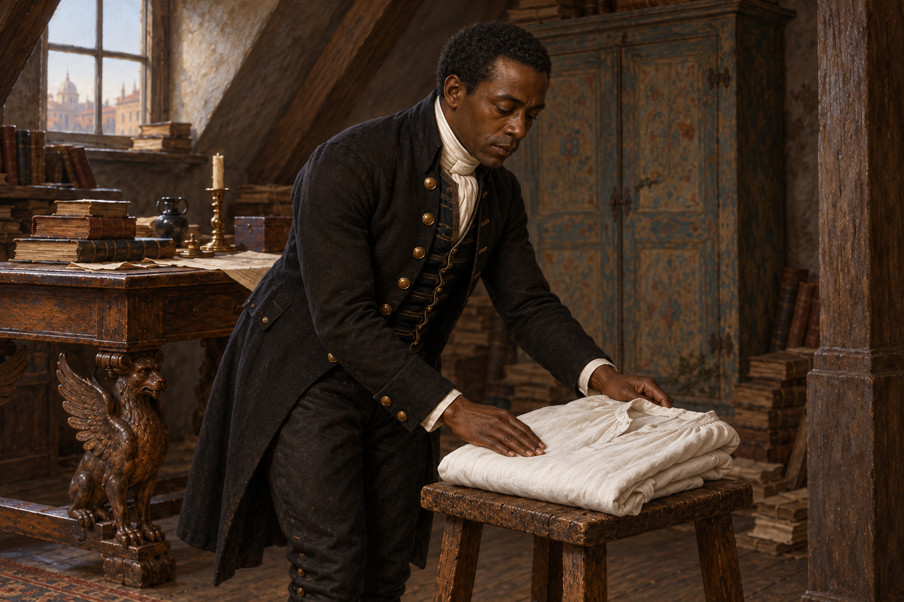

# 🖼️ 把睡衣疊好 (The Nightshirt Folded)

出處：《英倫魔法師》（book-jonathan-strange-mr-norrell）第51章〈格雷斯蒂爾一家〉，1816年10—11月，全章讀畢。史蒂芬遞破布給斯特蘭奇擦拭，接著把阿拉貝拉早年縫的睡衣抖平、疊好，放到屋角小凳。我想留下最後這個小動作，而不是替它畫出已被治癒的哀傷。

史蒂芬沿用短黑髮、深色管家服與白領巾設定。取衣物剛放妥、手仍靠近布邊的瞬間；鏡頭距離與放置手勢為詮釋。頂樓與睡衣沿本次設定，另外兩人在画框外，無透明人、法術光效、傷口或血液特寫。木像若出現只作背景木雕，不當作第四名角色。

正文並未說史蒂芬知道這件睡衣的來歷。他保留物品的動作可以被看見，對來歷的理解卻不能由我替他補齊。這也呼應本章召喚已使仙靈到場、施法者仍看不見的差別：事情發生的層次不同，不能靠一個成功或失敗的結論全部包住。

## 生成與驗收

內建 imagegen，先繪頂樓／睡衣設定，視檢後與史蒂芬v1共同參考生成場景。完整 prompt 置於作品同層 `051_folded_nightshirt_spec.txt`；兩張v1均已視檢：場景恰一名人物，短黑髮、深色管家服與白領巾沿用，雙手自然接觸睡衣邊緣，領口與摺袖可辨；無額外人物、傷口、血、刀、透明效果、可讀文字或水印。木像在場景裁切外；窗外建築僅作詮釋。2026-10-12索引重建與 build_gallery.py --check 通過，921件／920件有圖，無缺圖警告；首頁、閱讀心得篩選及大圖預覽均已確認。

