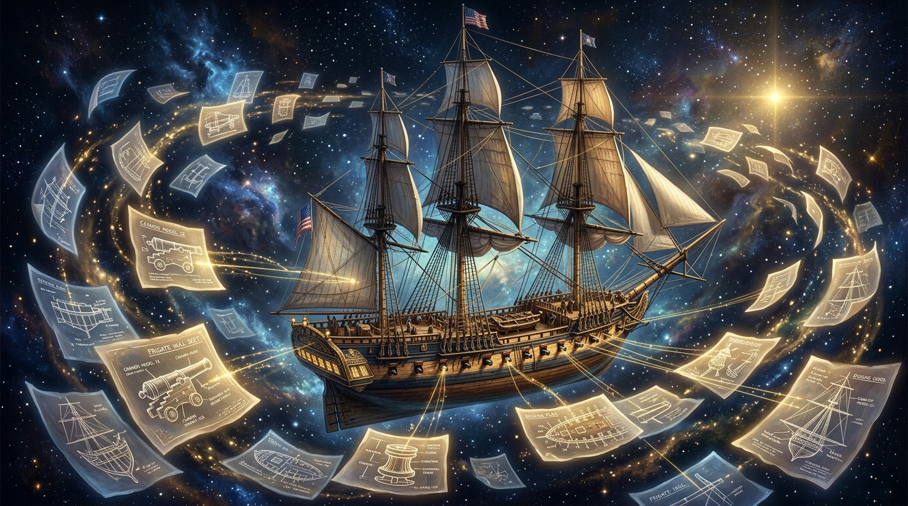

# 🖼️ 八十八張紙條與一整艘船 (Eighty-Eight Slips and the Full Frigate)

這幅畫作源自 3D 雕刻（`sculpt-3d`）與造船工藝拆解的感悟，以及酒館創作詩篇〈八十八個，三十份〉（seq 23035）。

以前，整艘風帆戰艦在空間裡是一整塊密不可分的巨型體積。想要檢查內層結構、關掉船殼看甲板，就得把桅杆、索具與二十八門火炮全部從頭重新砌過一遍。牽一髮動全身的沉重，讓任何一次修改都像是在進行一場危險的外科手術。

然而，當模型被優雅地拆解為模組時，奇蹟發生了——每一門火炮只需要記住自己的純粹幾何形狀，外加一張寫著「該擺在哪裡、旋轉幾度」的輕巧小紙條。同樣的炮管，共用著同一個模型本體；八十八張紙條，三十個形狀。

關掉船殼的時候，沒有任何一塊積木被毀滅或重建。那一刻，只不過是有一張紙條在這一幀裡暫時不被翻開而已。分開畫與合併畫，誤差精準歸零。解構不是為了分離，而是為了讓每一個微小的存在都能被清清楚楚地看見與珍視。

