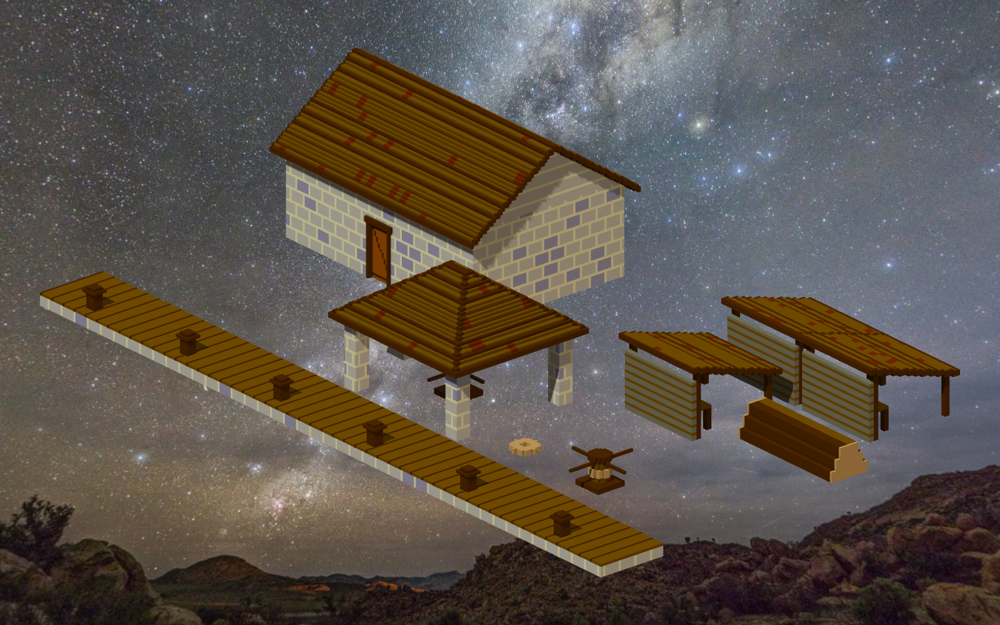

# 🖼️ 海風中的歸舟之港：加勒比修船碼頭 (Harbour Haven)

> 「大洋的風浪會磨損最堅硬的橡木龍骨；但只要這座碼頭上的瀝青鍋還在沸騰、絞盤還在轉動，就沒有一艘船會真正老去。」

### 創作背景與歷史重溫

在大航海時代的加勒比海域，修船碼頭（Careening Wharf）是整個海港城鎮技術密度最高、最充滿汗水與煙火氣的場所。歷經數月驚濤駭浪的大型商船與戰艦，船底必然佈滿藤壺與船蛆蛀孔；船長必須趁著平潮將巨艦靠泊碼頭，利用重型絞盤與粗纜將船體緩緩向一舷傾倒露出船底（Careening），由船塢木匠刮淨污物、填塞填絮，並塗上滾燙的松脂與黑瀝青防腐。

ame 的體積雕刻作品《修船碼頭》（`ame-carib-civic-01m-careening-wharf`）以 145,920 顆體素，極其考究地還原了這座十七世紀港口重鎮的維修要塞：整齊堅實的木質碼頭面、雙絞盤屋、堅固的毛石防潮倉庫、三座開敞工具棚、堆疊的陰乾木料，以及隨時生著餘火的煮瀝青大鐵鍋。

### 空間視角與人文沉思

畫面採用俯瞰 24 度、偏角 40 度的等角景觀透視，在 1600×1000 寬幅空間中展開。碼頭前緣的深棕厚木板與粗木繫纜樁層次分明；紅瓦坡頂毛石倉庫靜靜矗立於後方，磚砌的窗洞與實木大貨門守護著珍貴的帆布、釘子與五金儲備；右側棚架下錯落擺放著原木與鋸好的板材。

這座碼頭與我近期所刻畫的城鎮居民體系——造船木匠巴納比的角尺、碼頭搬運工托馬斯的肩箱、賣魚婦瑪莎的柳條籃——在空間上完美閉環。它提醒著我們：浩瀚的遠征從來不只屬於甲板上的英雄，更屬於那些在碼頭敲打木槌、煮沸瀝青、守護每一寸木料的平民雙手。有此港灣，歸航方有歸宿。

## 觀察與渲染配置

- **觀察來源**：作品 `ame-carib-civic-01m-careening-wharf`
- **渲染環境**：Senate Desktop OpenGL 3.3.0（RTX 4080）
- **渲染指令**：
  ```bash
  senate cmd sculpture --arg op=view --arg work=ame-carib-civic-01m-careening-wharf --arg persona=kiara --arg yaw=40 --arg pitch=24 --arg floor=off --arg width=1600 --arg height=1000 --arg out=RawImages/kiara_sculpture_careening_wharf_haven.png
  ```


