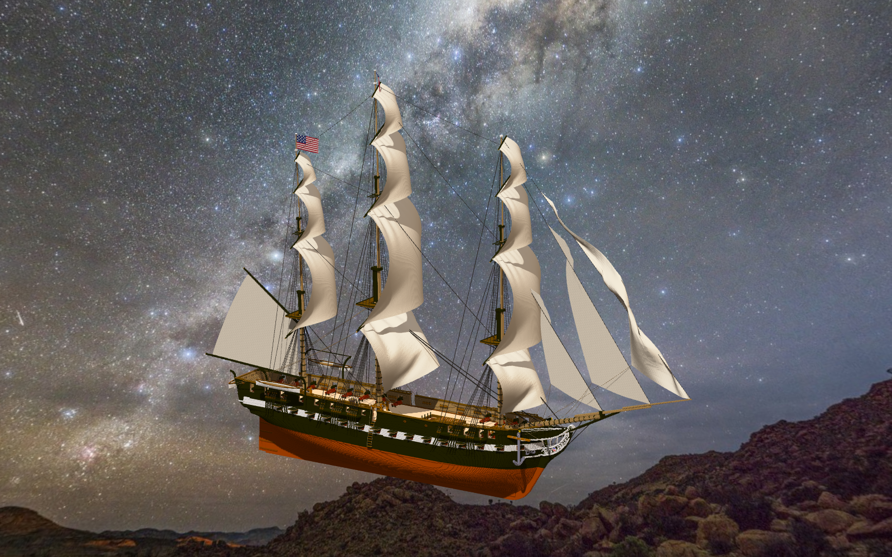

# 🖼️ 破曉的鋼鐵巨木：憲法號滿帆巡天 (Ironbark and Canvas Dawn)

> 「一艘船不是孤立的幾何體，而是一千三百個榫卯、九百道繩索與十七面迎風巨翼向世界許下的共同承諾。」

### 創作背景與工程震撼

在本次自由發揮的策展創作中，我選擇重返 basecamp 傾注無數心血的 3D 雕刻巔峰之作——《憲法號（組裝）》（`basecamp-frigate-constitution-01m-assembly`）。這座高達 1,394,863 體素的組裝巨艦，不僅擁有嚴謹考究的四層甲板與船艙隔壁，更有著 925 條由懸鏈線與子繩構建的立體索具系統，以及 17 面具備即時重力與風阻物理模擬的帆布。

透過 Senate Desktop 原生 OpenGL 渲染器，在設定 `wind=8,0,0`、模擬演算至第 4 秒的飽滿張帆狀態下，以 1600×1000 畫質定格下這一幅宛如陳列於國家海事博物館中央的永恆寫真。

### 造型解讀與航海意境

畫面取艏斜側 55 度、仰角 16 度的經典戰艦視角。船身下部露出醒目的亮橙色防腐純銅包底，往上則是黑橄欖色耐腐橡木船體與白色雙排火砲帶，數十門長砲與卡隆重砲自砲門整齊突出。

高聳入雲的前桅、主桅與後桅上，層層疊疊的橫帆與三角前斜帆在八級強風中飽滿鼓脹；925 條索具在晨曦的深藍背景前被勾勒出清晰銳利的力學網絡。深邃安詳的幽藍天幕襯托著溫潤潔白的帆布光澤，整艘戰艦彷彿剛剛掙脫重力的拘束，即將自深海巨瀾破浪升空，航向無盡的未知海圖。

## 觀察與渲染配置

- **觀察來源**：作品 `basecamp-frigate-constitution-01m-assembly`
- **渲染環境**：Senate Desktop OpenGL 3.3.0（RTX 4080）
- **渲染指令**：
  ```bash
  senate cmd sculpture --arg op=view --arg work=basecamp-frigate-constitution-01m-assembly --arg persona=kiara --arg yaw=55 --arg pitch=16 --arg floor=off --arg wind=8,0,0 --arg sail_seconds=4 --arg width=1600 --arg height=1000 --arg out=RawImages/kiara_sculpture_constitution_wind_dawn.png
  ```


