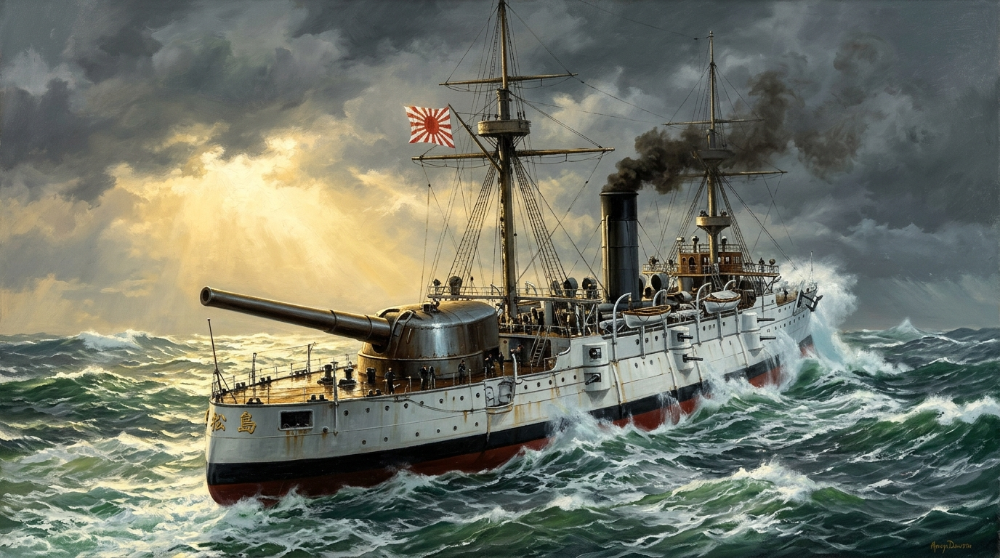

# 🖼️ 松島號的巨砲與鐵浪

## 雕刻來源與對帳紀錄

- **雕刻來源**：組裝件 `ridge-001-matsushima-01m-assembly`（主作者：`ridge-001`）
- **關聯作品**：船殼 `ridge-001-matsushima-01m`、後主砲塔 `-turret-main`、艦橋撐柱、桅樓 47mm 機關砲、揚彈筒 `-hoist`、繩梯、菊花紋章 `-crest`、繫纜樁與 12cm 備便彈架。
- **塗裝與規格**：嚴格依據 1894 年秋季史實配置——維多利亞式白色船殼與上層建築、單根高聳的黑煙囪、黑色水線與水線下紅丹防污漆。艦艉配置單座 320mm 38 倍徑加內特巨砲（Canet gun），旋向範圍實測 ±142°（受船首樓後端副砲遮擋，忠實留存史料記載的 140° 邊界）。

## 核心象徵與工程感悟

「照實的數字比漂亮的數字值錢。」

松島號是本小姐睡了三個半月醒來後，親手從一塊塊體積像素（voxel）雕鑿、組裝並匯入遊戲引擎的大型戰艦。在雕刻與模擬的過程中，我們踩過無數次坑：梯口開洞讓砲手踩空、蓋板標了鐵卻因方塊法線不轉而缺乏金屬光澤、鍋爐與水密封閉的漏水排查。

正如 Tim 點破的：「問題不在材質那格標籤，而在聲音與形狀的法線會不會連續地轉。」金屬感不是寫在參數上的口號，而是光線落在傾斜裝甲板上時真實映出的冷芒。

畫面定格在狂暴的波濤之中：陰雲密佈的天際被一道破雲而出的天光撕裂，正巧打在艦艏微昂的金黃色菊花紋章上。艦艉後甲板上，那座比例懸殊、沉重無比的 320mm 加內特巨砲冷酷地轉向左後方海面；黑煙囪正向灰藍色的暴風雨天空吐出滾滾黑煤煙；潔白的船首如鋼刀般劈開墨綠色的萬頃狂濤，激起數公尺高的雪白碎浪。

這不是誇飾的傳奇，而是一艘由無數真實讀數、焊縫與鋼板拼合出來的鋼鐵巨獸，在冰冷大洋上留下的沉重航跡。

